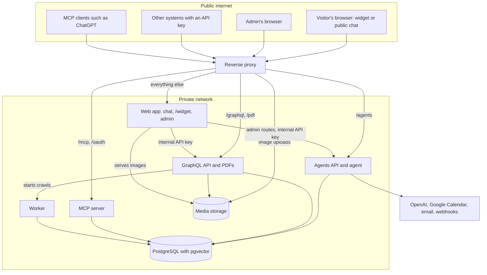

Lumi combines a public website conversation with business knowledge, meeting tools, and a team administration interface.

## Request flow

1. A visitor opens the public chat or the embeddable launcher.
2. The widget loads the frontend's chat iframe.
3. The frontend sends conversation requests to the streaming agents API.
4. The agent uses business services and knowledge tools, calls OpenAI, and persists conversation state in PostgreSQL.
5. Configured integrations support actions such as meeting booking; the team reviews content and conversations through the admin interface.

[Request flow](/concepts/request-flow) follows one message through these steps in detail.

## Components

| Component             | Responsibility                                                                          |
| --------------------- | --------------------------------------------------------------------------------------- |
| Frontend              | Next.js public chat at `/`, `/widget`, and admin pages; server-side admin access checks |
| Agents API            | Streaming conversation routes and the LangGraph agent                                   |
| GraphQL API           | Apollo API for application data                                                         |
| Business services     | Shared knowledge and entity operations used by application interfaces                   |
| PostgreSQL / pgvector | Application data, vector-backed retrieval, and checkpoint storage                       |
| Widget                | Website launcher and iframe integration                                                 |
| MCP server            | An additional interface to selected business capabilities                               |
| Worker                | Website crawls and scheduled cleanup of conversation data                               |
| Media storage         | S3-compatible storage for the images admins upload                                      |
| Reverse proxy         | The container installation's only public entry: TLS and routing to the services         |
| Deployment            | Container images and Compose installation                                               |

Shared chat types and schemas live in the [`packages/shared-contracts`](https://github.com/nieve-consulting/lumi/tree/main/packages/shared-contracts) package of Lumi's source. [MCP server](/developers/mcp-server) documents the MCP server's authentication and public-data policy.

## How the components connect

The diagram shows the container installation. Only the reverse proxy is published; every other service is reachable only on the installation's private network.

- **Public entry.** Visitors, admins, other systems and MCP clients all reach the installation through the reverse proxy. It sends `/agents` to the agents API, `/graphql` and `/pdf` to the GraphQL API, `/mcp`, `/oauth` and the OAuth discovery documents to the MCP server, image uploads to media storage, and every other path to the web app.
- **Private calls.** The web app's server calls the GraphQL API and the agents API's `/admin` routes with the installation's internal API key. The GraphQL API refuses that key on requests that come through the proxy, and the agents API's `/admin` routes aren't routed by the proxy at all. The GraphQL API starts website crawls on the worker.
- **Data.** The agents API, the GraphQL API, the MCP server and the worker keep their data in PostgreSQL. The GraphQL API and the web app use media storage for uploaded images; the agents API, the MCP server and the worker have no access to it.
- **Outbound.** The agent calls OpenAI for replies and embeddings, and the handoff routes use the configured integrations: Google Calendar for bookings, and email or webhooks for enquiries. Other services also call OpenAI, which the diagram leaves out: the web app for admin writing help and translations, the worker to embed crawled pages, and the MCP server to draft a project from a web page.

## Boundaries to preserve

Public visitor access and team administration have different permissions. Keep privileged credentials server-side and review public/private knowledge visibility when adding tools. An agent's instructions alone are not an authorization boundary. [Boundaries](/concepts/boundaries) describes what each side can reach.

Each installation serves one business. A shared multi-tenant managed service, tenant isolation guarantees, and a generic integration framework are not established by this architecture description.

For implementation conventions, follow Lumi's `AGENTS.md` and the relevant workspace guide ([Contributing](/developers/contributing)). For operational dependencies, see [Self-hosting](/self-hosting).
