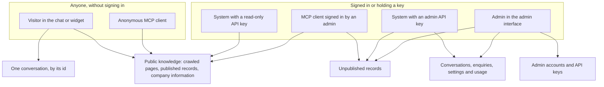

A Lumi installation has two sides. The public side is what anyone on the internet can reach without signing in: the chat, the widget and the published knowledge the assistant answers from. The private side is what only the business's team and the systems it trusts can reach: unpublished records, conversations, enquiries, settings and the credentials that protect them. This page explains where that line runs. [Security](/security) reviews every trust boundary, the limits that protect the public side and the operator checklist in full.

## Who can reach what

Each row below states what the diagram shows, and how Lumi checks it.

| Who | Reaches | How it is checked |
| --- | --- | --- |
| Visitor in the public chat or the widget | The public agents API (`/agents`): start a conversation, send messages, read their own conversation, book a meeting, send an enquiry | Nobody signs in. A conversation is identified by its id, a random UUID the visitor's browser keeps. Per-address limits apply |
| Website embedding the widget | The `/widget` page in an iframe, and the launcher's settings (`/api/business`): the assistant's name, default language and colour | Nothing it reports is trusted: a page address is only used when it is on the business's own sites |
| Anonymous MCP client | The MCP server's public tools | None. They always run with public access, whatever token is sent |
| System with a read-only API key | The GraphQL API, limited to an allowlist of queries for published records and public business information | The key, generated by an admin, checked on every request. Lumi stores only its hash |
| MCP client signed in by an admin | The MCP server's team tools: read unpublished records, create, update, publish and unpublish them | OAuth with PKCE. The token's scope and the admin's account (or Google group membership) are checked on every call |
| System with an admin API key | The GraphQL API: everything the admin interface does except managing API keys and administrators | As for read-only keys |
| Admin | The admin interface: knowledge, settings, conversations, enquiries, usage, administrators and API keys | A session the web app's server checks on every admin page, server action and route. See [Admin access](/configuration/admin-access) |
| Web app's server and Lumi's services | The GraphQL API with full access, and the agents API's `/admin` routes | The installation's internal API key, `LUMI_API_KEY`. It only works on the private network |

The MCP server's team tools cover the knowledge records only: team members, projects, clients, capabilities, work experience and job openings. They don't reach conversations, enquiries or settings. See [MCP server](/developers/mcp-server) and [API keys](/developers/api-keys).

## What is public

Everything the assistant can use is public: anyone can read it by asking the chat. That covers:

- the pages of the websites admins add, which Lumi crawls and which are already public on the web;
- the team members, projects, clients and job openings that admins have published, for the knowledge sources that are turned on, and the capabilities linked to published team members and projects;
- the company information.

An unpublished record is reported as not found, exactly like a missing one, and is never named or linked from a published one. The same rules apply to the chat's tools, the MCP server's public tools and read-only API keys, because they all read through the same business services with public access. See [Knowledge](/configuration/knowledge).

A few other things are served without signing in: the launcher's settings for the widget, and the images admins upload, such as team member photos, which the web app serves at `/media`.

## What is private

These never reach a visitor or an anonymous caller:

- **Unpublished records** and draft translations.
- **Conversations and enquiries**, including the contact details visitors enter. The only exception is a visitor's own conversation: whoever holds its id can read and continue it, so treat a conversation id like a private link.
- **Settings and usage**: business, knowledge, handoff and appointment settings, webhook destinations and the model costs on the usage page.
- **Admin accounts and API keys.** Admin passwords are stored as scrypt hashes and API keys as SHA-256 hashes, and a new key is shown once.
- **Secrets**: the OpenAI key, `LUMI_API_KEY`, the session and MCP token secrets, SMTP, Google and Langfuse credentials. They stay in the backend services' and the web app server's settings. The only setting compiled into the code that runs in the browser is the agents API's address.

## Where the boundary is enforced

- **In code, not in the prompt.** Every tool the assistant can call is a read-only lookup of public knowledge, so a visitor or a crawled page that tries to override the assistant's instructions can't make it reveal private data or act for the team. Bookings and enquiries are separate requests that the server validates and only delivers to destinations the admins configured. An agent's instructions alone are not an authorization boundary.
- **At the network edge.** In the container installation only the reverse proxy is published. It doesn't route the agents API's `/admin` routes, and the GraphQL API refuses `LUMI_API_KEY` on any request that came through the proxy, so a leaked internal key can't be used from the internet there.
- **In the services.** Lumi's business services decide what public access may read, and check the team permission again on every team operation, whatever the caller already checked.

## Setting up a new installation

Until the business is set up, every page of the web app except the widget's leads to the onboarding wizard at `/setup`, which anyone who reaches the installation can open. Set `LUMI_SETUP_TOKEN` so that only someone who has it can complete the wizard; with email and password sign-in, the wizard creates the first admin and requires the token. Remove the token once the setup is complete. See [Configuration](/configuration).
