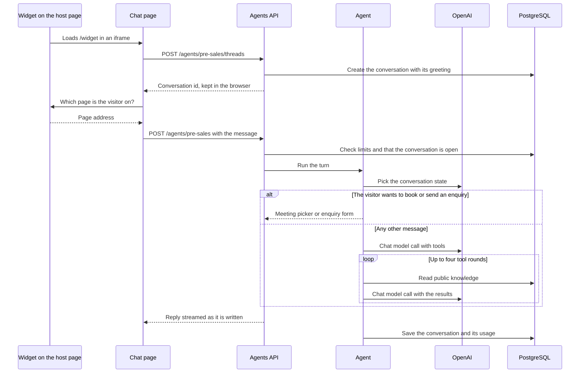

This page follows one visitor message through a Lumi installation: from the chat in the visitor's browser, through the streaming agents API and the agent, to the knowledge it looks up, and back as a streamed reply. It describes the container installation. [Architecture](/concepts/architecture) introduces the components.

## Overview

## 1. The chat loads

The visitor opens Lumi in one of two ways:

- **On a website that embeds the widget.** The widget script renders a launcher on the host page. It first asks the installation for the launcher's settings (`/api/business`), and the first time the visitor opens the launcher it loads the installation's `/widget` page in an iframe. The widget passes the page title and language set on it to the iframe.
- **On the public chat page** at the installation's own address (`/`).

Both pages run the same chat in the visitor's browser. They are served by the web app, but the chat then calls the agents API directly from the browser: in the container installation, the reverse proxy routes `/agents` on the installation's own address to the agents API and streams its responses without buffering.

## 2. A conversation starts

When the visitor sends their first message, the chat creates a conversation with `POST /agents/pre-sales/threads`. Inside the widget, it first asks the host page which page the visitor is on, through a message between the iframe and the widget, and sends that address along.

The agents API:

1. Counts the request against the limit of new conversations per visitor address, and refuses it once the day's spending limit is reached.
2. Records the page the chat started on, but only when it belongs to the business website, a website Lumi crawls, or the installation itself.
3. Creates the conversation in PostgreSQL and saves the greeting, in the chat's language, as its first message.
4. Answers with the conversation id, a random UUID. The browser keeps it in local storage so the conversation survives a reload, and reloads it later with `GET /agents/pre-sales?threadId=…`.

## 3. The message is sent

Each message is a `POST /agents/pre-sales` request carrying the message, the conversation id, the chat's language, the page title and, when there is one, the address of the page the visitor is on. The browser drops addresses with query parameters (other than tracking ones), fragment routes or path segments that look like personal data, and removes tracking parameters before sending.

Before running the agent, the agents API:

1. Counts the message against the per-address message limit and checks the daily spending limit.
2. Checks that the business is set up and validates the request.
3. Marks the conversation as active and checks that it exists, isn't closed by a booking or an enquiry, and hasn't reached its message limit.
4. Keeps the page address only when it is on the business website or a website Lumi crawls, so a visitor can't make Lumi read any other page.

[Security](/security) lists every limit and its default.

## 4. The agent runs

The agent is a LangGraph graph whose state is saved in PostgreSQL (in the `langgraph` schema) under the conversation id. Each turn runs these steps:

1. **Determine the state.** A small OpenAI call reads the last few messages and picks the conversation state: gathering the visitor's needs, answering questions about the company, talking to a job candidate, or arranging a meeting or an enquiry. It also notes the language of the visitor's message.
2. **Handoff**, when the visitor wants to book a meeting, send an enquiry or be contacted. The agent shows what the business has set up: a meeting picker for the team's Google Calendar, a card with the booking page's link, an enquiry form, or a reply with the business's contact details when none is set up. The meeting picker and the enquiry form are prefilled by another OpenAI call that extracts the visitor's details and their answers to the qualification questions from the conversation. The turn ends here.
3. **Call the chat model** in every other state. The model gets the system prompt, built from the business settings, the conversation so far and a short context for this turn: the conversation state and the page the visitor is on. It is bound to every tool the installation's knowledge sources make available, and the conversation state decides which of them it may call.
4. **Run the tools** the model called, then call the model again with their results. After four rounds of tool calls in one turn, the model must reply with what it found.

### Tools and knowledge retrieval

Every tool is a read-only lookup of public knowledge. None writes, sends or books anything.

| Tool | What it reads |
| --- | --- |
| `webpage_search` | The pages of the business's websites. An OpenAI call first rewrites the question into a self-contained search query using the last few messages. The query is embedded with OpenAI, and PostgreSQL's pgvector ranks the crawled pages' passages by cosine distance. The closest passages come back with their page's title and address. The chat links up to three of the turn's closest pages under the reply as related pages, each once and without the page the visitor is reading. |
| `read_current_page` | The page the visitor is on, fetched live, when the turn has one. Only allowed on turns with a page address the agents API accepted. |
| `get_company_info` | The business's company information. |
| `get_team_members`, `get_team_member` | Published team members, when that source is on. |
| `get_projects`, `get_project` | Published projects, when that source is on. |
| `get_clients`, `get_client` | Published clients, when that source is on. |
| `get_job_openings`, `get_job_opening` | Published job openings, when that source is on. |

The record tools read through Lumi's business services with public access, the same services the MCP server's public tools use, so unpublished records are never found. See [Knowledge](/configuration/knowledge) for the sources and [Boundaries](/concepts/boundaries) for what counts as public.

## 5. The reply streams back

The agents API streams the turn to the browser as it runs, as an AI SDK UI message stream over server-sent events:

- the reply's text as the model writes it;
- status updates such as "Looking for information..." while a tool runs, which the chat shows and doesn't keep;
- the cards and references of the reply, such as a meeting picker or the pages a search used.

Tool calls and their results are never sent to the browser, and errors reach it only as a generic message; the details stay in the logs and, when it is on, in Langfuse tracing. If the visitor stops the reply or closes the page, the agents API stops the run.

When the turn ends, the agent saves the conversation, including the new messages, as one checkpoint in PostgreSQL, and the agents API records the cost of the turn's model calls for the admin usage page and the daily spending limit.

## 6. Bookings and enquiries

The agent itself never books or sends anything. The visitor's browser sends a separate request once they fill in the card the agent showed:

- **`POST /agents/pre-sales/booking`** books a meeting from the meeting picker. The agents API checks that the picker was shown in this conversation, that calendar booking is still on, that the time fits the appointment settings and is still free in the hosts' calendars, then adds the event to Google Calendar and closes the conversation.
- **`POST /agents/pre-sales/enquiry`** sends an enquiry from the form. The agents API checks that the form was shown in this conversation and validates every field, saves the enquiry in PostgreSQL, delivers it by the email or webhook channels the admins set up, and closes the conversation once a channel accepted it.

Both count against the per-address limit of bookings and enquiries. [Handoff](/configuration/handoff) explains how to set them up.

## Admin requests

The admin interface reads conversations differently. The web app's server, acting for a signed-in admin, calls the agents API's `/admin` routes with the installation's internal API key to read a conversation's messages or summarize it, and the GraphQL API for everything else. Those routes aren't reachable through the reverse proxy.
