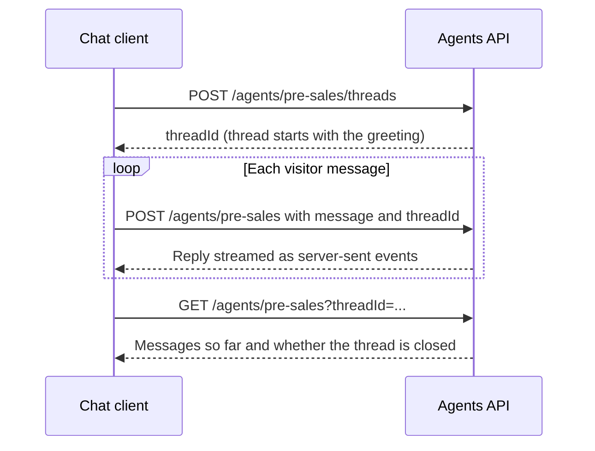

The agents API runs Lumi's assistant. Lumi's public chat page and the [widget](/using-lumi/embedding-the-widget)'s chat call it from the browser: they start a conversation, send each visitor message, and receive the reply as a stream while the assistant writes it. The request and response shapes are shared by the chat and the API in Lumi's code (`@lumi/shared-contracts/pre-sales` and `@lumi/shared-contracts/chat`).

Records, settings and conversations for your own systems are in the [GraphQL API](/developers/graphql-api), not here.

## Endpoint

| Installation | Base address |
| --- | --- |
| Container | `LUMI_PUBLIC_URL/agents`, for example `https://lumi.example.com/agents`, through the installation's proxy |
| Local development | `http://localhost:8080/agents`, through the local proxy (see [Getting started](/getting-started)) |

The pre-sales assistant's routes are under `/agents/pre-sales`. They are public: they need no key, as visitors use them without signing in.

- **Browsers:** responses only carry `Access-Control-Allow-Origin` for the origins in the backend's `AGENTS_ALLOWED_ORIGINS`, so only pages on those origins can call the API from a browser. The container installation sets it to `LUMI_PUBLIC_URL`, the origin the chat runs on, also inside the widget's iframe. Requests may send `Content-Type` and use `GET`, `POST` and `OPTIONS`.
- **Limits:** the routes are rate limited per client address and by an optional daily spending limit (see [Limits and errors](#limits-and-errors)).

The API also has `/admin/pre-sales/...` routes, which only take the installation's own key and serve the admin interface's conversation pages and summaries. The container installation's proxy doesn't expose them.

## Conversations and threads

A conversation is a thread, identified by a UUID. The assistant keeps each thread's messages on the server, so a client sends only the visitor's new message with each turn, never the history.



In words: the client creates a thread and keeps its id, sends each message with that id and reads the streamed reply, and can fetch the thread's messages again, for example after a page reload. Lumi's chat keeps the thread id in the browser's local storage, so a visitor who comes back finds their conversation.

<Callout type="warn">
The thread id is the conversation's only credential: anyone who has it can read the conversation and add to it. Keep it in the visitor's browser and don't put it in URLs, logs or analytics.
</Callout>

A thread closes when the visitor books a meeting, when an enquiry is delivered, or when it reaches its message limit. A closed thread takes no more messages; the client starts a new one.

## Routes

| Method and path | Does |
| --- | --- |
| `POST /agents/pre-sales/threads` | Starts a thread |
| `POST /agents/pre-sales` | Runs one turn and streams the reply |
| `GET /agents/pre-sales?threadId=` | Returns the thread's messages and whether it is closed |
| `POST /agents/pre-sales/booking` | Books a meeting from the in-chat calendar |
| `POST /agents/pre-sales/enquiry` | Sends an enquiry from a handoff card |

Until the installation's first-run setup is finished, the routes that start or continue a conversation answer `503`.

### Start a thread

`POST /agents/pre-sales/threads` with a JSON body:

| Field | Type | Description |
| --- | --- | --- |
| `language` | `string`, optional | The chat's language, `en` or `es`, as a BCP 47 tag. Missing or unsupported: the installation's default language |
| `pageUrl` | `string`, optional | The page the chat started on. Recorded with the conversation only when it is on the business website, a website Lumi crawls, or the Lumi installation itself, keeping only its `utm_source`, `utm_medium`, `utm_campaign` and `utm_id` parameters. An unusable value is dropped, not rejected |

The answer is `{ "threadId": "<uuid>" }`. The thread starts with the assistant's greeting in the chat's language: the business's own greeting, or Lumi's default one.

### Send a message

`POST /agents/pre-sales` with a JSON body:

| Field | Type | Description |
| --- | --- | --- |
| `message` | `string` | The visitor's message, 1 to 4,000 characters |
| `threadId` | `string` | The thread's id |
| `language` | `string`, optional | The chat's language, for the fixed text the API writes during the turn, such as status updates. The assistant replies in the language the visitor writes in, whatever this is |
| `pageTitle` | `string`, optional | The title of the page the visitor is on. Longer titles are cut to 300 characters |
| `pageUrl` | `string`, optional | The page the visitor is on now. The assistant may read it to answer questions about it, when it's on the business website or a website Lumi crawls. Only an address that identifies the page by itself is kept: one with query parameters other than tracking ones, a `#/` route, or a path that looks like it holds personal data or a token is dropped |

The answer is a stream, described next. A thread that doesn't exist gets `404`; a closed one gets `409`.

### Read a thread

`GET /agents/pre-sales?threadId=<uuid>` answers:

```json
{
  "messages": [{ "id": "…", "role": "assistant", "parts": [{ "type": "text", "text": "Hello! …" }] }],
  "closed": false
}
```

`messages` are AI SDK UI messages, as the stream builds them, with Lumi's cards and references in each message's `metadata`.

### Book a meeting and send an enquiry

These two routes act on the cards the assistant shows (see [Qualification, booking and enquiries](/configuration/handoff)):

- **Booking** takes `threadId`, the meeting picker's message id as `deleteMessageId`, `language` and `data`: the visitor's `email`, optional `name` and `phone`, the `topic` and `summary`, the `slot` as a `[start, end]` pair of Unix timestamps in seconds, and optionally the visitor's `timeZone` and `locale`. Only a free time within the appointment settings is booked; another gets `400` with the code `slot_unavailable`. A booked meeting closes the thread and replaces the picker with a confirmation.
- **Enquiry** takes `threadId`, the handoff card's `messageId`, a `submissionId` (a UUID the client makes once per enquiry, so a retry never sends it twice), `language` and `data`: `contact` fields, `answers` to the qualification questions and an optional `message`. It answers `{ "status": "delivered", "replyTo": … }` once a delivery channel accepted it, which closes the thread, or `502` with `{ "status": "failed" }` when none did; the enquiry is kept for the team to retry from the admin interface. Problems with the visitor's details get `400` with a `problems` list by field.

While another booking or enquiry of the same thread is running, both answer `423`: send the same request again in a moment.

## The stream

A turn's answer is a [server-sent events](https://html.spec.whatwg.org/multipage/server-sent-events.html) stream (`Content-Type: text/event-stream`) in the AI SDK's UI message stream format, version 1 (the `x-vercel-ai-ui-message-stream: v1` header). The AI SDK's chat clients, such as `useChat` from `@ai-sdk/react`, read it as they are; Lumi's chat uses it that way.

Each event is a `data:` line holding one JSON chunk. A turn's chunks, in order:

| Chunk `type` | Carries |
| --- | --- |
| `start` | The start of the assistant's message |
| `start-step`, `finish-step` | The boundaries of each step of the assistant's work |
| `text-start`, `text-delta`, `text-end` | The reply's text, as it is written: `delta` holds each new piece, `id` ties a text part's chunks together |
| `reasoning-start`, `reasoning-delta`, `reasoning-end` | The model's reasoning, when it gives one. Lumi's chat doesn't show it |
| `data-status` | A transient status update for the visitor, such as what the assistant is looking up, in `data.message`. It isn't kept with the message |
| `message-metadata` | Cards and references in `messageMetadata`: `cards` (each `{ card_type, id, payload }`, such as a project, team member, meeting picker or handoff card) and `references` (each `{ title, url }`, the pages the reply used) |
| `error` | A failure during the turn. `errorText` is always `An error occurred.`: the details are only logged |
| `finish` | The end of the message |

The stream ends with `data: [DONE]`. While the assistant is silent, for example while a tool runs, the API sends a `: keep-alive` comment every 5 seconds; SSE clients ignore it. The assistant's tool calls and their results aren't streamed.

If the client disconnects, the turn stops. The turn's messages are saved when it ends, also when it fails or is stopped.

## Example

Start a thread, then send a message and print the stream as it arrives:

```bash
curl https://lumi.example.com/agents/pre-sales/threads \
  -H "Content-Type: application/json" \
  -d '{"language":"en"}'
# {"threadId":"3f0c8f9e-5d2a-4b7e-9c1d-2a6b8e4f7a10"}

curl -N https://lumi.example.com/agents/pre-sales \
  -H "Content-Type: application/json" \
  -d '{"threadId":"3f0c8f9e-5d2a-4b7e-9c1d-2a6b8e4f7a10","message":"What do you do?","language":"en"}'
```

The second request prints chunks such as:

```text
data: {"type":"start"}

data: {"type":"data-status","data":{"message":"…"},"transient":true}

data: {"type":"text-start","id":"…"}

data: {"type":"text-delta","id":"…","delta":"We help"}

data: {"type":"text-end","id":"…"}

data: {"type":"finish"}

data: [DONE]
```

## Limits and errors

Every error answer has the body `{ "error": "<message>" }`. Refusals the chat explains to the visitor add a `code`:

| Status | `code` | Meaning |
| --- | --- | --- |
| `429` | `rate_limited` | Too many requests from the visitor's address. `retryAfterSeconds` and the `Retry-After` header say when to try again |
| `409` | `thread_limit` | The conversation reached its message limit. Start a new one |
| `409` | `thread_closed` | The conversation ended with a booking or an enquiry. Start a new one |
| `503` | `unavailable` | The installation's daily spending limit was reached |
| `400` | `slot_unavailable` | The meeting's time isn't free or bookable any more. Pick another |

Other errors have no code: `400` for an invalid body or thread id, `404` for an unknown thread, `503` before the setup is finished.

The operator sets the limits with these variables of the agents service:

| Variable | Default | Limit |
| --- | --- | --- |
| `LUMI_CHAT_TURNS_PER_MINUTE` | `20` | Messages per visitor address and minute |
| `LUMI_CHAT_THREADS_PER_MINUTE` | `10` | New conversations per visitor address and minute |
| `LUMI_HANDOFFS_PER_HOUR` | `5` | Bookings and enquiries together per visitor address and hour |
| `LUMI_MAX_MESSAGES_PER_CONVERSATION` | `50` | Visitor messages in one conversation |
| `LUMI_DAILY_SPEND_LIMIT_USD` | None | Model spending per UTC day, in US dollars, for all conversations together |

`0` turns a count limit off. See [Limits](/security#limits) for how they protect an installation.
