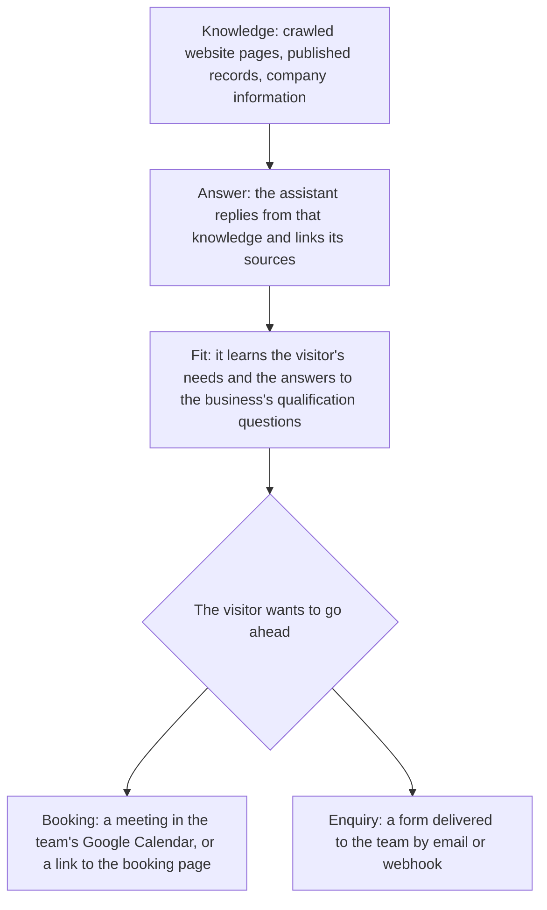

Lumi is an AI concierge for a business's website. Visitors ask it questions in a chat on your site. It answers from what your business has published, learns what the visitor needs, and helps them take the next step: book a meeting with your team or send an enquiry. Your team manages Lumi's knowledge and reviews conversations in an admin interface.

Nieve Consulting built Lumi for its own website and maintains it as an open-source project under the GNU Affero General Public License v3 (AGPL v3). The widget that websites embed to show Lumi's chat is licensed under the Apache License 2.0, so any website can embed it.

See Lumi answering at [chat.lumi.nieve.ai](https://chat.lumi.nieve.ai), the installation Nieve runs on its own website.

## Who it's for

- **Businesses that sell expertise**, such as consultancies, agencies, studios and practices, that want their website to answer questions and turn interest into conversations with the team.
- **Agencies** that set Lumi up for their clients. They can adapt it, install it and offer implementation or hosting services under its license.

Each installation serves one business. It has three kinds of users:

- **Visitors and prospective clients** chat on the business's website, either on Lumi's own chat page or in a chat launcher embedded on any page. Nobody has to sign in.
- **Job candidates** use the same chat to ask about working at the business and the roles it's hiring for.
- **The team** signs in to the admin interface to manage knowledge, settings and conversations.

## The visitor journey

A conversation moves from what the business knows, to an answer, to whether the visitor is a fit, to a booking or an enquiry.

1. **Knowledge.** The assistant only uses public knowledge: the pages of the websites you add, which Lumi crawls; the team members, projects, clients and job openings you have published, for the sources you turn on; and your company information. Unpublished records never reach a conversation. See [Knowledge](/configuration/knowledge).
2. **Answer.** For each message the assistant looks up what it needs with read-only tools, such as a search over your website's pages, and streams its reply, linking the pages it used. When it finds nothing, it says it doesn't have that information rather than guessing.
3. **Fit.** While the visitor describes their needs, the assistant asks the business's qualification questions where they fit naturally in the conversation, one or two at a time, and never holds back a visitor who wants to go ahead.
4. **Booking or enquiry.** When the visitor asks to meet, to send their details or to be contacted, the chat shows what the business has set up: a meeting picker that books a free time in the team's Google Calendar, a link to the business's booking page, an enquiry form delivered by email or webhook, or a combination. The form comes prefilled from the conversation, including the answers to the qualification questions, and the visitor reviews it before sending. A booking or a delivered enquiry ends the conversation. Without any of these set up, the assistant points the visitor to the business's contact details. See [Handoff](/configuration/handoff).

Job candidates follow a shorter path: the assistant answers from the published job openings, the company information and the website, and points them to the careers page or the team.

## What Lumi does today

- Answers in a streaming chat, on its own page or embedded on any website with a launcher ([Embedding the widget](/using-lumi/embedding-the-widget)).
- Reads the page the visitor is on, when that page belongs to one of the business's websites.
- Asks configurable qualification questions and hands off to a booking or an enquiry.
- Chats in English and Spanish.
- Gives the team an admin interface for knowledge, settings, conversations and model usage ([Admin interface](/using-lumi/admin-interface)).
- Offers a GraphQL API, a streaming agents API and an MCP server for other systems ([Developers](/developers/graphql-api)).

## Status and limitations

Lumi is a maintained project with regular releases. It runs Nieve's own website, and another business can install it without changing its source code.

Know these limits before you adopt it:

- **One business per installation.** Lumi isn't a multi-tenant service: an agency runs one installation per client, and there is no tool to manage several installations together.
- **OpenAI only.** Replies, helper calls and embeddings all use OpenAI models, so every installation needs an OpenAI API key.
- **Two chat languages.** The chat is available in English and Spanish. The admin interface is in English.
- **Written knowledge comes from your websites.** Lumi learns your services, pricing, articles and FAQs by crawling the websites you add.
- **Google Calendar for in-chat booking.** Booking inside the chat works with Google Calendar. With another calendar, link to your booking page instead.
- **Enquiries by email or webhook.** Lumi delivers enquiries to email addresses or a webhook; it has no built-in connection to specific customer-management tools.
- **Admin sign-in** is by email and password or with Google Workspace.

## Two ways to run Lumi

- **Self-host it.** Run the complete product on your own server with Docker Compose. You need a host with Docker and an OpenAI API key. Start with [Self-hosting](/self-hosting).
- **Use Nieve's managed option.** Nieve Consulting runs Lumi for you. See [lumi.nieve.ai](https://lumi.nieve.ai) for details.

## Explore the docs

<Cards>
  <Card title="Getting started" href="/getting-started" description="Run Lumi locally and make a first installation." />
  <Card title="Self-hosting" href="/self-hosting" description="Requirements, settings and the container installation." />
  <Card title="Configuration" href="/configuration" description="Business identity, knowledge, qualification and handoff, admin access." />
  <Card title="Using Lumi" href="/using-lumi/embedding-the-widget" description="Embed the chat on your website and work in the admin interface." />
  <Card title="Concepts" href="/concepts/architecture" description="Architecture, request flow and public/private boundaries." />
  <Card title="Security and data" href="/security" description="Trust boundaries, data and privacy, and reporting vulnerabilities." />
  <Card title="Developers" href="/developers/contributing" description="Contribute to Lumi and use its APIs and MCP server." />
</Cards>
