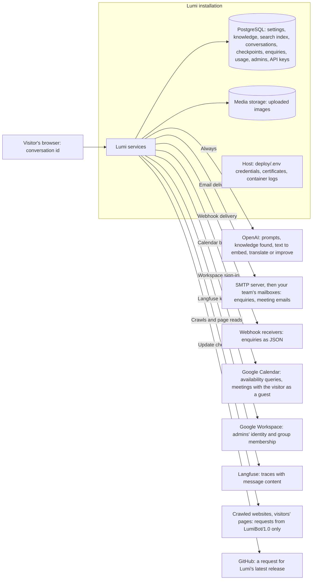

This document lists where a Lumi installation keeps data, which copies leave it, and how export, retention and deletion treat each one. It is written for operators of a [self-hosted installation](/self-hosting) and of isolated managed installations, which run the same containers. It is a guide to configuring and operating Lumi, not a compliance certification: whether your use meets your legal obligations depends on your business, your notices and your providers.

The procedures are in [Operations](/self-hosting/operations).

## Where data lives

An installation keeps its data in these durable stores. Your own backups must cover them: Lumi ships no backup tooling.

| Store                          | Where (Compose installation)                        | What it holds                                                                                                                                                           |
| ------------------------------ | --------------------------------------------------- | ----------------------------------------------------------------------------------------------------------------------------------------------------------------------- |
| PostgreSQL, `public` schema    | `postgres-data` volume, or your PostgreSQL server   | Business configuration, knowledge, the search index, conversations, enquiries, usage, admin accounts, API keys and MCP sign-in state; see [the database](#the-database) |
| PostgreSQL, `langgraph` schema | `postgres-data` volume, or your PostgreSQL server   | Conversation checkpoints: the full message history and state of each conversation, which the chat resumes from                                                          |
| PostgreSQL, `drizzle` schema   | `postgres-data` volume, or your PostgreSQL server   | The schema migrations applied, which tell which release the database is at                                                                                              |
| Media storage                  | `storage-data` volume, or your S3-compatible bucket | Images admins upload: team member photos, client and experience logos, project images and uploaded logos in the business and resume settings. Optional                  |
| Settings file                  | `deploy/.env` on the host                           | The installation's credentials: database password, internal API key, session and MCP token secrets, OpenAI key, SMTP, storage, Google and Langfuse credentials          |
| Certificates                   | `caddy-data` volume                                 | TLS certificates and their private keys. Reissued automatically if lost                                                                                                 |
| Container logs                 | Docker's log files on the host                      | Operational events and errors; see [Logs](/self-hosting/operations#logs)                                                                                                           |

Nothing else on the host is durable: the containers keep no state of their own. The web app keeps rendered pages in memory for up to an hour, and the backend services cache the business settings for a few seconds.

### The database

| Data                   | Tables                                                                                                                                                                                                                         | Personal data                                                                                          |
| ---------------------- | ------------------------------------------------------------------------------------------------------------------------------------------------------------------------------------------------------------------------------ | ------------------------------------------------------------------------------------------------------ |
| Business configuration | `business_settings`, `handoff_settings`, `resume_settings`, `knowledge_settings`, `appointment_settings`                                                                                                                       | Business contact details. Enquiry email recipients and the booking calendar's email                    |
| Structured knowledge   | `company`, `team_members`, `experience`, `capabilities`, `clients`, `projects`, `job_openings`, their links (`team_member_capabilities`, `project_capabilities`, `project_team_members`) and their `*_translations`; `uploads` | Team members' names, bios, education and work history, published or not                                |
| Website knowledge      | `websites`, `website_pages`, `website_crawls`                                                                                                                                                                                  | Whatever the crawled pages say. `website_crawls` records the email of the admin who started each crawl |
| Search index           | `website_page_vectors`: page passages and their embeddings                                                                                                                                                                     | As the pages                                                                                           |
| Conversations          | `threads`: topic, summary, the visitor's name, email and phone when they gave them, the page they started on, and cost                                                                                                         | Yes                                                                                                    |
| Enquiries              | `enquiries`: contact fields, qualification answers, message; `enquiry_deliveries`: each delivery channel's state and latest error                                                                                              | Yes                                                                                                    |
| Usage                  | `thread_usage`: tokens and cost of each model call, per conversation; `admin_usage`: the same for the admin's AI features, per admin                                                                                           | Admin emails in `admin_usage`                                                                          |
| Daily spending limit | `daily_conversation_spend`: one total cost per UTC day, independent of conversations | No visitor or conversation identifiers; date and cost only |
| Admins and access      | `admin_accounts` (password hashes), `admin_sign_in_failures` (hashed), `api_keys` (secret hashes), `oauth_*` (hashed MCP codes and tokens), `mcp_audit_events`, `mcp_idempotency_keys`, `mcp_rate_limits`                      | Admin emails and names. Rate-limit buckets are hashed and hold no addresses                            |

The chat also keeps the visitor's conversation id in their browser's local storage, so a returning visitor continues the conversation. It holds no message content.

## Copies outside the installation

Some data leaves the installation while Lumi works. Deleting it in Lumi doesn't delete these copies: each provider keeps them under its own retention, which you configure in your account with that provider.

| Destination                       | When                                       | What it receives                                                                                                                           |
| --------------------------------- | ------------------------------------------ | ------------------------------------------------------------------------------------------------------------------------------------------ |
| OpenAI                            | Always                                     | Prompts with the conversation so far and the knowledge found for it; page and search text for embeddings; text admins translate or improve |
| Enquiry email recipients, SMTP    | With email delivery                        | Each enquiry: contact fields, qualification answers, topic, message and a link to the conversation                                         |
| Webhook receivers                 | With webhook delivery                      | Each enquiry, as JSON; see [Handoff](/configuration/handoff#webhook)                                                                                   |
| Google Calendar                   | With calendar booking                      | Availability queries, and the meeting with the visitor's name and email as a guest; the hosts are also emailed                             |
| Google Workspace                  | With Workspace sign-in                     | Admins' identity and group membership checks                                                                                               |
| Langfuse                          | With Langfuse keys set                     | Traces of conversations and admin AI calls, including message content                                                                      |
| Crawled websites, visitors' pages | When crawling, or reading a visitor's page | Requests from `LumiBot/1.0`. Nothing about visitors is sent                                                                                |
| GitHub                            | Unless `LUMI_UPDATE_CHECK=off`             | A request from the `api` service for Lumi's latest release, about twice a day and on each `status` run. Nothing about the installation, not even its version; GitHub sees the server's address |
| Your backups                      | When you take them                         | Whatever the stores above held at the time                                                                                                 |

Review providers' terms and data settings for your own accounts. Don't assume they share the same retention or processing.

The diagram summarises both tables. Inside the installation, Lumi's services keep data in PostgreSQL and in media storage, and the host keeps `deploy/.env`, the certificates and the container logs; the visitor's browser keeps only the conversation id. OpenAI always receives prompts, knowledge found and text to embed or translate. Only once you configure them do the others receive data: enquiries and meeting emails go out through your SMTP server to your team's mailboxes, enquiries go to webhook receivers, meetings go to Google Calendar, admins' identity and group membership checks go to Google Workspace, and traces with message content go to Langfuse. Crawled websites and visitors' pages only receive requests from `LumiBot/1.0`.

## Export

`export` writes the business's setup to a file, to move it to another installation; see [Moving to another installation](/self-hosting/operations#moving-to-another-installation). The file holds:

- every business, handoff, resume, knowledge and appointment setting;
- every structured record in every language, published or not, with its translations and drafts;
- the websites to crawl (address, sitemap, exclusions), but not their crawled pages or search index, which the new installation rebuilds by crawling;
- the uploaded images that records and settings use, unless you leave them out with `--without-media`.

Daily spending totals stay on the original installation and are not exported.

It holds no visitor data: no conversations, checkpoints, enquiries, deliveries or usage. It holds no admin accounts, password hashes, API keys, MCP sign-ins or audit records: you create admins again on the new installation.

Webhook signing secrets are left out unless you pass `--include-secrets`. The import then skips those webhook channels and names them, so you add them again with your receiver's secret. Email recipients, the booking calendar's address and the business's contact details are configuration and always included. Keep an export as private as the admin interface: it holds unpublished records and team members' personal details, and with `--include-secrets` a credential.

## Retention

Out of the box, Lumi keeps everything until someone deletes it, with one exception: the worker's weekly checkpoint cleanup deletes old checkpoint history that the chat no longer needs. It keeps each conversation's latest state, so it doesn't shorten how long conversations are kept.

To keep conversations for a limited time, set `CONVERSATION_RETENTION_DAYS` in `deploy/.env`. The worker then deletes every conversation whose last activity is older than that many days, once a day at 02:30 UTC, with its checkpoints, enquiries, deliveries and usage; see [Retention](/self-hosting/operations#retention). It is off by default because deleting conversations also removes them from the admin's conversation list and their cost from the dashboard.

Other data has no automatic retention:

| Data                               | How long it is kept                                                                  |
| ---------------------------------- | ------------------------------------------------------------------------------------ |
| Knowledge, settings, images        | Until an admin deletes them                                                          |
| Crawled pages and their index      | Until a crawl finds them gone or excluded, or an admin clears or deletes the website |
| Daily spending totals | Indefinitely; conversation deletion and retention do not remove them |
| Website crawl history, admin usage | Indefinitely                                                                         |
| MCP codes and tokens               | Expire after use; their rows stay until the installation is deleted                  |
| Container logs                     | Up to 50 MB per service in the Compose installation, rotated by Docker               |
| Copies outside the installation    | As each provider and your backups keep them                                          |

## Deletion

| To delete                       | How                                                                                                                       | Also deleted                                                             |
| ------------------------------- | ------------------------------------------------------------------------------------------------------------------------- | ------------------------------------------------------------------------ |
| One conversation                | **Conversations** in the admin, or `delete-conversations --thread <id> --apply`                                           | Its checkpoints, enquiries, enquiry deliveries and usage                 |
| A visitor's conversations       | `delete-conversations --email <address> --apply`; see [Deleting a visitor's data](/self-hosting/operations#deleting-a-visitors-data) | As above, for every conversation where they gave that email              |
| Conversations older than a date | `delete-conversations --older-than <days> --apply`, or `CONVERSATION_RETENTION_DAYS`                                      | As above                                                                 |
| A record                        | Delete it in the admin                                                                                                    | Its translations, links to other records and its images in media storage |
| A website's knowledge           | **Clear pages** or delete the website in **Knowledge → Websites**; for single pages, an exclusion and **Update pages**    | Its pages and their passages in the search index                         |
| The whole installation          | [Retiring an installation](/self-hosting/operations#retiring-an-installation)                                                        | Everything in the stores above                                           |

Deleting conversations removes their detailed usage, but keeps the anonymous daily spending totals used to enforce the [spending limit](/security#limits).

Deletion takes effect at once in the chat, the MCP server and the GraphQL API: they read the database on every request. Two limits apply:

- **Old conversations remember what they were told.** A conversation that quoted a record or page before it was deleted keeps that text in its own history until the conversation is deleted.
- **Copies outside the installation stay.** Deleting a conversation doesn't delete the enquiry emails your team received, the webhook receiver's copy, the calendar invitation, Langfuse traces or what OpenAI retains under your account's settings. Delete those where they live.

### Backups

Deleting data in a running installation doesn't erase it from backups taken before. Lumi can't reach your backups, or a managed service's, so it can't delete from them. Data deleted from the live installation stays in each backup until that backup expires or you delete it. If you restore a backup, the data deleted since it was taken comes back: delete it again before reopening the installation. Keep backups only as long as your retention policy allows, and protect them like the database itself.

## Operator responsibilities

Tell visitors who operates the assistant, what you collect, why, how long you keep it and how to contact you. Avoid collecting sensitive information the enquiry doesn't need, and set `CONVERSATION_RETENTION_DAYS` to match your policy.

When you receive an access or deletion request, account for the installation, the copies outside it and your backups, as described above. Deleting in one place doesn't establish deletion in the others.

Restrict public knowledge to material you are authorized to publish. Check visibility through the public interfaces before you turn on a new source. Keep private production material out of bug reports and demonstrations.

Trust boundaries, limits and the operator checklist are in [Security](/security). Report suspected exposure privately, as [SECURITY.md](/security/reporting-vulnerabilities) describes.
