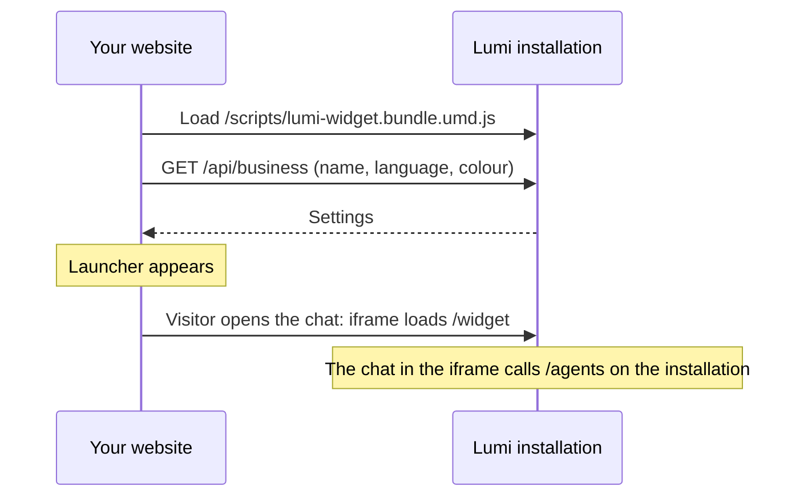

The widget puts Lumi's chat on any website. A small launcher button runs on your page; when a visitor opens it, the chat loads from your Lumi installation's `/widget` page in an iframe. The chat itself, its answers and its data stay on your installation: your website only hosts the button.



In words: your page loads the widget script from your installation, the launcher asks the installation for its assistant name, default language and primary colour, and then shows itself. The first time a visitor opens it, the launcher loads `/widget` from the installation in an iframe. Everything the visitor types goes from that iframe to the installation's agents API, never through your page.

## Add the widget to a page

Every Lumi installation serves the widget at `/scripts/lumi-widget.bundle.umd.js`. Loaded from there, it connects to that installation and uses its settings, so it needs no options but `selector`:

```html title="Your page"
<script src="https://lumi.example.com/scripts/lumi-widget.bundle.umd.js"></script>
<div id="lumi-widget"></div>
<script>
  LumiWidget.init({ selector: "lumi-widget" })
</script>
```

Replace `https://lumi.example.com` with your installation's address. `selector` is the `id` of the element the widget renders in. If no element has that id, nothing is shown and the browser console says so.

The launcher sits in the bottom-right corner of the window, whatever element you render it in, and the chat opens above it. Visitors close the chat with the launcher, or with <kbd>Escape</kbd>.

### Open the chat from your own links

Any link on the page whose `href` is exactly `#open-lumi` opens the chat when clicked, for example a "Talk to us" button in your page's content:

```html
<a href="#open-lumi">Ask our assistant</a>
```

When the visitor closes the chat, focus goes back to the link that opened it.

## Options

`LumiWidget.init` takes these options:

| Option | Type | Default | Used for |
| --- | --- | --- | --- |
| `selector` | `string` | Required | The `id` of the element the widget renders in |
| `origin` | `string` | See [Choosing the installation](#choosing-the-installation) | The Lumi installation to connect to, such as `https://lumi.example.com` |
| `assistantName` | `string` | The installation's assistant name | The assistant's name in the launcher's labels and the chat's title |
| `language` | `string` | None | The chat's language. See [Choosing the language](#choosing-the-language) |
| `ctaText` | `string` | None: a round icon launcher | The text of a pill-shaped launcher, shown instead of the round icon |
| `iconSize` | `number` | `60` | The round launcher's size in pixels |
| `color`, `backgroundColor` | `string` | See below | The launcher's text and background colours |
| `className` | `string` | None | A class for the launcher button, to style it from your own stylesheet |
| `pageTitle` | `string` | None | The host page's title, passed on to the chat |

Launcher colours:

- When you set none of `color`, `backgroundColor` or `className`, the launcher is white on the installation's primary colour.
- When the installation has no primary colour either, the launcher has no background and uses your page's text colour.
- `color` and `backgroundColor` override the installation's colour. With `className`, your class decides the colours.

The widget's labels, such as "Chat with Ada", come from the widget itself. `ctaText` is shown exactly as you write it, so write it in your page's language.

### Example

```html
<script src="https://lumi.example.com/scripts/lumi-widget.bundle.umd.js"></script>
<div id="lumi-widget"></div>
<script>
  LumiWidget.init({
    selector: "lumi-widget",
    language: "es",
    ctaText: "Habla con nosotros",
    pageTitle: document.title,
  })
</script>
```

## Settings from your installation

The launcher reads the assistant's name, the default language and the primary colour from the installation each time a page loads it, with `GET <origin>/api/business`. You set them in the admin interface (see [Configuration](/configuration)), so changes reach new page loads without changing your website. The options above override them. A CDN in front of the installation may keep these settings for a few minutes; while the installation isn't set up yet, the answer is never cached, so the launcher appears as soon as the setup is finished.

The launcher appears once the installation answers:

| The installation | What visitors see |
| --- | --- |
| Is set up | The launcher, with the installation's settings |
| Isn't set up yet (its first-run setup isn't finished) | No launcher. The browser console says the installation isn't set up yet |
| Isn't a Lumi installation (`/api/business` answers `404`, such as a copy of the script on a CDN without an `origin` option) | No launcher. A console error says to pass `origin` |
| Doesn't answer within 3 seconds, answers with another error or with something unexpected | The launcher with neutral settings: the name Lumi, no colour, and English unless the `language` option says otherwise. A console warning gives the reason |

## Choosing the installation

The widget connects to the first of these:

1. The `origin` option.
2. `LUMI_WIDGET_ORIGIN`, if it was set when the widget was built. A widget built with it keeps connecting there wherever it's copied to, such as a CDN.
3. For the script tag bundle (`lumi-widget.bundle.umd.js`): the origin of the script it was loaded from. This is what makes the simple embed above work.
4. In development builds only: `http://localhost:8080`, the local development proxy (see [Getting started](/getting-started)).

An origin is an absolute `https://` or `http://` URL with no path, query, fragment or credentials, such as `https://lumi.example.com`; a trailing `/` is fine. An invalid `origin` option isn't skipped in favour of the next: the widget isn't shown, and the console says why. When no installation can be found, the widget isn't shown either, and the console says how to fix it.

The widget reads the origin once, when it starts.

## Choosing the language

The chat is shown in the installation's default language (English unless an admin changed it) unless the page sets the `language` option to a [BCP 47](https://www.rfc-editor.org/info/bcp47) tag:

```js
LumiWidget.init({ selector: "lumi-widget", language: "es" })
```

- The chat can be shown in English (`en`) and Spanish (`es`).
- Tags match by their base language, so `es-MX` or `es-ES` show the chat in Spanish. Underscore forms such as `es_ES` (WordPress's locale) work too.
- A missing, unsupported or malformed tag falls back to the installation's default language, in the chat and in the launcher's labels.
- The widget doesn't follow the visitor's browser language: only the `language` option and the visitor's own choice change it. To follow your site's language, pass the language each page is in.
- Visitors can switch language from the chat's menu. Their choice wins over the `language` option, and the launcher's labels follow it once the chat has opened. Some browsers block storage inside iframes; there, the choice lasts until the chat reloads.

The assistant replies in the language the visitor writes in, whatever the chat's language is. The chat's language sets its interface and fixed messages.

## What the widget shares with the chat

- **Page title:** the `pageTitle` option goes to the chat, which sends it with each message.
- **Page address:** when a conversation starts, and with every message, the chat asks the launcher which page the visitor is on. The launcher only answers the chat it loaded, on the installation's origin.
  - When the conversation starts, Lumi records the page with the conversation, for your team to see in the admin interface. It keeps only the campaign parameters (`utm_source`, `utm_medium`, `utm_campaign`, `utm_id`) of the address's query, drops the fragment, and only records pages on your business website, a website Lumi crawls, or the Lumi installation itself.
  - With each message, the assistant may read the page the visitor is on to answer questions about it, when the page is on your business website or a website Lumi crawls. Addresses whose query or fragment changes what the page shows, or whose path looks like it carries personal data or a token, aren't used.

See [Data and privacy](/security/data-and-privacy) for what conversations store.

## Requirements on your website and installation

- **Content Security Policy:** if your website sends a `Content-Security-Policy` header, allow your installation's origin in `script-src` (for the script tag), `connect-src` (for the settings) and `frame-src` (for the chat). For example: `script-src 'self' https://lumi.example.com; connect-src 'self' https://lumi.example.com; frame-src https://lumi.example.com`.
- **Framing:** any website may show the installation's `/widget` page in an iframe. Every other page of the installation, including `/admin` and `/setup`, refuses to be framed.
- **License:** the widget script is licensed under the Apache License 2.0, not the AGPL v3 that covers the rest of Lumi, so embedding it puts no AGPL obligations on your website.
- **Agents API origins:** the chat in the iframe runs on your installation's own origin and calls its agents API from there, so that origin must be in the backend's `AGENTS_ALLOWED_ORIGINS`. The container installation sets it to `LUMI_PUBLIC_URL` for you (see [Self-hosting](/self-hosting)). Your website's own origin doesn't need to be listed.

## Using the widget in a React app

The widget can also be built as an ES module that exports a `Widget` React component, for sites built with React that bundle the widget into their own scripts. The component takes the same options as props, except `selector`, and takes a `style` prop in place of `color` and `backgroundColor`. Your app provides React and React DOM.

The ES module is bundled into your own scripts, so it can't tell which installation it came from: pass the `origin` prop, or build it with `LUMI_WIDGET_ORIGIN` set to your installation's origin. Building it is a contributor task described in the `widget/` folder of Lumi's source.
